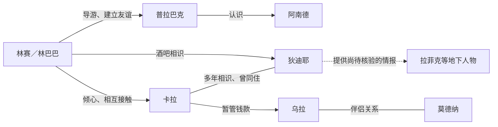

# 《项塔兰》｜04 人物档案与关系（随读随更新，无剧透）

**范围**：仅截至第一册第二章海堤夜谈、卡拉说自己在美国长大（用户已读，EPUB：`OEBPS/text00007.html`约第258段）。**本文件不是全书人物百科**，名字、动机、关系随阅读修正；不将酒吧传闻当事实，不提前揭示后文。更新：2026-10-31。

## 核心人物

| 人物（首次出现） | 截至断点已知背景 | 目前与林赛 / 其他人的关系 | 可靠性与待解问题 |
|---|---|---|---|
| **林赛 / 林 / 林巴巴**（第一章） | 第一人称主人公；来自澳大利亚，曾入狱后逃亡，持另一身份的旅行证件抵达孟买；过去曾写作，逃亡中继续记笔记 | 由普拉巴克带路并获赠昵称；对卡拉产生强烈吸引；在利奥波德认识狄迪耶等人 | 以多年后的回忆叙事，可能为过去赋予后来才形成的意义 |
| **普拉巴克·哈瑞／普拉布**（第一章） | 孟买街头导游，外向善谈，对当地街巷和交易很熟悉；自小通过城市生活学习不少知识 | 林赛的导游、逐渐成为朋友；替林赛取名“林／林巴巴”；与旅馆经理阿南德熟识 | 当前以相处中的行动判断，不把热情等同于已经验证的完全可靠 |
| **卡拉**（第一章） | 初见时救林赛避开车辆；自称来自瑞士巴塞尔、在美国长大，提及父母已去世；在孟买生活多年，对自身工作谈得有限 | 林赛迷恋她；与狄迪耶相识多年，曾同住；帮助乌拉暂管一笔钱；与一位未明身份的雇主有关 | 她谈自己、旁人谈她，以及林赛的想象要分开 |
| **狄迪耶·利瓦伊**（第二章） | 法国人、常驻利奥波德，熟悉各种人脉和交易，自述在孟买住了八年；幽默而尖刻 | 林赛新结识的酒吧朋友；与卡拉是多年旧识，曾经同住；向林赛讲述地下社会人物 | 他提供的关系情报属角色陈述，未经独立证实 |
| **阿南德**（第一章） | 印度旅社经理，熟悉游客和当地生意 | 接待林赛和两位加拿大游客，认识普拉巴克 | 第一章叙述者曾从多年后回顾两人的关系；不据此提前编造其经历 |

## 利奥波德酒吧及周边已登场人物

| 人物 | 已知身份与相互关系 | 证据边界 |
|---|---|---|
| **乌拉** | 德国女子，在利奥波德社交圈与莫德纳同行；私下交给林赛一卷钱，之后由卡拉收下暂管 | 她的个人处境主要来自言语及他人的描述，尚未形成独立全貌 |
| **莫德纳** | 西班牙男子，从事游客之间的非正规买卖；乌拉的伴侣 | 他对乌拉的想法尚不可从旁人推测为确定事实 |
| **拉菲克** | 狄迪耶向林赛指出的阿富汗男子，据说与护照生意纠纷有关 | **狄迪耶的说法**，不视作证实的犯罪档案 |
| **拜拉姆** | 狄迪耶指出的伊朗男子，据称涉及护照买卖势力争夺 | 信息来自狄迪耶 |
| **埃杜尔·迦尼** | 狄迪耶口中拜拉姆的上级联系人 | 截至目前仅听闻 |
| **阿布德尔·哈德汗（哈德拜）** | 狄迪耶所说当地地下势力的重要人物 | **仅被提到**，尚无直接接触，不添加后来剧情 |
| **桑杰·德什潘德** | 第一章修理收音机的店主，收购普拉巴克转让的酒 | 与普拉巴克有小生意往来 |
| **莉蒂希亚、毛里齐欧、卡维塔** | 第二章酒吧圈的名字已被提到 | 当前断点以前尚未完成背景介绍，留待下一段阅读，不提前填写 |

另有两位与林赛同车、同住首晚旅馆的加拿大旅客，姓名尚未核实，以“加拿大旅客甲／乙”暂记，勿编造。

## 目前的人物关系图

## 更新规则

- 人物“亲眼见到的行动／本人自述／其他人转述／林赛猜测／Joi猜测”严格分开，**先读到才添加**。
- 新人物先记姓名、初遇位置与当下关系；发生重大变化时补充日期及章节，不改写早期人物当时所知。
- 讨论特殊身份或关系时只使用当前章节实际支持的内容，避免提前透露人物命运。

## 2026-11-01｜第二章结束后的人物增量（已读内容，不剧透）

| 人物 | 新补充的已读信息 | 信息来源与边界 |
|---|---|---|
| 林赛 | 第二章末对卡拉表达明显的赞赏，陪她回到住处门口，然后独自返回旅馆；用户对他当前动机的原话是「渴望自由，期待新的开始，充满好奇，不断探索」。 | 用户原话是人物解读，不是小说原句；林赛对关系的想象也不等于卡拉的真实意图。 |
| 卡拉 | 介绍利奥波德朋友的经历，尤其同情乌拉，并对爱情中不断牺牲个人独立的处境表示警惕；在海堤上认识一位行动不便的青年。 | 这些是卡拉表达的态度，不能未经证实推断她自己的经历。 |
| 莉蒂希亚 | 曾在果阿和伦敦之间往返寻找精神生活；熟悉珠宝生意，替外国客户购买宝石与首饰收取佣金；工作由狄迪耶介绍。 | 大部分背景来自卡拉介绍；她与狄迪耶表面争执，实则友好。 |
| 毛里齐欧 | 意大利男子，曾继承遗产并挥霍；卡拉以蝎子与青蛙的寓言提醒林赛提防他。 | 这是卡拉对其行为风险的评价，不能当作独立查证的结论；林赛有嫉妒。 |
| 乌拉 | 据卡拉讲述，早年家境富裕、曾陷入毒品依赖，后来在印度受到一位德国男子的利用；卡拉同情她。 | 注意**那位德国男子并不是本章酒吧里作为乌拉伴侣出现的西班牙人莫德纳**；对乌拉过去的了解仍是卡拉转述。 |
| 莫德纳 | 西班牙男子，乌拉在酒吧里相伴的人，从事非正规交易；外貌和沉默气质受到林赛注意。 | 不把他与乌拉过去的德国伴侣混淆；尚不推断他的真实动机。 |
| 卡维塔 | 自由撰稿人，期待成为记者，卡拉赞赏她的聪明、坦率和勇气。 | 是卡拉当晚向林赛提供的评价。 |
| 海堤上的年轻人 | 乘简陋带轮木板、用双手灵活移动的身体残障青年，与卡拉相识，并郑重地向两人道别。 | 第二章末直接发生的情节；姓名未核实，不擅自取名。 |

**当前阅读断点**：第一册第二章已读完，下一次从第一册第三章开篇开始；上方旧版“截至卡拉谈美国成长”的说明只代表当时的历史快照，以本节最新断点为准。

## 2026-11-01｜第四章开篇人物补充

- **维克兰·帕特尔**：三十岁上下的印度男子，由卡拉带到利奥波德并介绍给林赛、莉蒂希亚；此前曾去丹麦旅行，返孟买一两周；擅长夸张、粗俗的自嘲笑话。具体职业、后续行为尚未共读。
- **费德里科**：由乌拉、狄迪耶等人聊天时提起，尚非直接登场；据众人所说，他最近开始严格奉行宗教信仰，戒掉了原先的放纵生活。其改变原因与真实处境未核实，不自行添加。
- **普拉巴克**：邀请林赛前往其马哈拉施特拉邦北部家乡；狄迪耶将普拉巴克之前带林赛看城市阴暗面解读为一次交友考验，注意这是狄迪耶的推断，而非普拉巴克亲口确认。
- **林赛／卡拉／毛里齐欧**：林赛观察到毛里齐欧与卡拉坐得很近，因此再次产生嫉妒；不由此推断卡拉的实际情感选择。

**本文件最新阅读范围**：第一册第四章开场酒吧群聊，维克兰丹麦经历的笑话讲至尾声；其后的情节尚未纳入。
