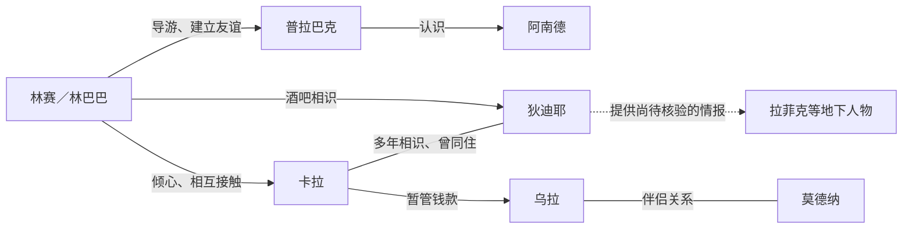

# 《项塔兰》｜04 人物档案与关系（随读随更新，无剧透）

**范围**：仅截至第一册第二章海堤夜谈、卡拉说自己在美国长大（用户已读，EPUB：`OEBPS/text00007.html`约第258段）。**本文件不是全书人物百科**，名字、动机、关系随阅读修正；不将酒吧传闻当事实，不提前揭示后文。更新：2026-10-31。

## 核心人物

| 人物（首次出现） | 截至断点已知背景 | 目前与林赛 / 其他人的关系 | 可靠性与待解问题 |
|---|---|---|---|
| **林赛 / 林 / 林巴巴**（第一章） | 第一人称主人公；来自澳大利亚，曾入狱后逃亡，持另一身份的旅行证件抵达孟买；过去曾写作，逃亡中继续记笔记 | 由普拉巴克带路并获赠昵称；对卡拉产生强烈吸引；在利奥波德认识狄迪耶等人 | 以多年后的回忆叙事，可能为过去赋予后来才形成的意义 |
| **普拉巴克·哈瑞／普拉布**（第一章） | 孟买街头导游，外向善谈，对当地街巷和交易很熟悉；自小通过城市生活学习不少知识 | 林赛的导游、逐渐成为朋友；替林赛取名“林／林巴巴”；与旅馆经理阿南德熟识 | 当前以相处中的行动判断，不把热情等同于已经验证的完全可靠 |
| **卡拉**（第一章） | 初见时救林赛避开车辆；自称来自瑞士巴塞尔、在美国长大，提及父母已去世；在孟买生活多年，对自身工作谈得有限 | 林赛迷恋她；与狄迪耶相识多年，曾同住；帮助乌拉暂管一笔钱；与一位未明身份的雇主有关 | 她谈自己、旁人谈她，以及林赛的想象要分开 |
| **狄迪耶·利瓦伊**（第二章） | 法国人、常驻利奥波德，熟悉各种人脉和交易，自述在孟买住了八年；幽默而尖刻 | 林赛新结识的酒吧朋友；与卡拉是多年旧识，曾经同住；向林赛讲述地下社会人物 | 他提供的关系情报属角色陈述，未经独立证实 |
| **阿南德**（第一章） | 印度旅社经理，熟悉游客和当地生意 | 接待林赛和两位加拿大游客，认识普拉巴克 | 第一章叙述者曾从多年后回顾两人的关系；不据此提前编造其经历 |

## 利奥波德酒吧及周边已登场人物

| 人物 | 已知身份与相互关系 | 证据边界 |
|---|---|---|
| **乌拉** | 德国女子，在利奥波德社交圈与莫德纳同行；私下交给林赛一卷钱，之后由卡拉收下暂管 | 她的个人处境主要来自言语及他人的描述，尚未形成独立全貌 |
| **莫德纳** | 西班牙男子，从事游客之间的非正规买卖；乌拉的伴侣 | 他对乌拉的想法尚不可从旁人推测为确定事实 |
| **拉菲克** | 狄迪耶向林赛指出的阿富汗男子，据说与护照生意纠纷有关 | **狄迪耶的说法**，不视作证实的犯罪档案 |
| **拜拉姆** | 狄迪耶指出的伊朗男子，据称涉及护照买卖势力争夺 | 信息来自狄迪耶 |
| **埃杜尔·迦尼** | 狄迪耶口中拜拉姆的上级联系人 | 截至目前仅听闻 |
| **阿布德尔·哈德汗（哈德拜）** | 狄迪耶所说当地地下势力的重要人物 | **仅被提到**，尚无直接接触，不添加后来剧情 |
| **桑杰·德什潘德** | 第一章修理收音机的店主，收购普拉巴克转让的酒 | 与普拉巴克有小生意往来 |
| **莉蒂希亚、毛里齐欧、卡维塔** | 第二章酒吧圈的名字已被提到 | 当前断点以前尚未完成背景介绍，留待下一段阅读，不提前填写 |

另有两位与林赛同车、同住首晚旅馆的加拿大旅客，姓名尚未核实，以“加拿大旅客甲／乙”暂记，勿编造。

## 目前的人物关系图

## 更新规则

- 人物“亲眼见到的行动／本人自述／其他人转述／林赛猜测／Joi猜测”严格分开，**先读到才添加**。
- 新人物先记姓名、初遇位置与当下关系；发生重大变化时补充日期及章节，不改写早期人物当时所知。
- 讨论特殊身份或关系时只使用当前章节实际支持的内容，避免提前透露人物命运。
